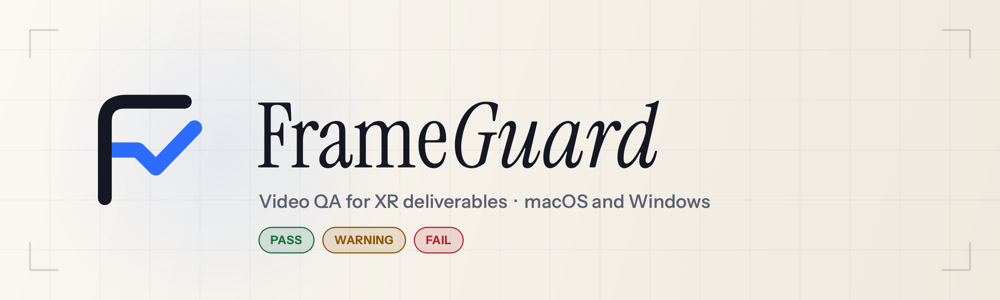

<p align="center">
  <picture>
    <source media="(prefers-color-scheme: dark)" srcset="assets/brand/banner-dark.png">
    
  </picture>
</p>

<p align="center">
  <a href="https://github.com/cass-ale/FrameGuard/releases/latest"></a>
  <a href="https://github.com/cass-ale/FrameGuard/actions/workflows/tests.yml"></a>
  
  <a href="LICENSE"></a>
</p>

<p align="center">
  <b>Published by Capri la Ria · Developed by Cassian Aléria</b><br>
  <a href="#download">Download</a> · <a href="#see-it-work">See it work</a> · <a href="#what-it-checks">What it checks</a> · <a href="#presets">Presets</a> · <a href="#build-from-source">Build from source</a>
</p>

FrameGuard checks video files against a delivery specification before they leave set
or the edit: resolution, frame rate, codecs, audio, loudness, XR metadata and every
decoded frame. Each file gets a plain-language verdict, the evidence behind it, and a
report you can hand over. Everything runs locally; no footage leaves the machine.

## See it work


A real deep scan in FrameGuard v0.9.0: six test files against the 4K UHD @ 30 fps
profile. Two pass, two pass with warnings (a burst of black frames, a stretch of
silence) and two fail (a 1080p 24 fps proxy, and a 4K file encoded at less than half
the minimum bitrate). It ends on the Checks matrix, where the failing checks come first.

<table>
  <tr>
    <td width="33%" valign="top"><b>Catches what breaks deliveries</b><br>Truncated copies, decode errors, wrong frame rate or size, variable frame rate, interlacing, silent or dead audio channels, missing 360 metadata.</td>
    <td width="33%" valign="top"><b>Explains every verdict</b><br>One readable line per file, the measured value next to the spec for every check, and anything that could not be verified says so instead of passing.</td>
    <td width="33%" valign="top"><b>Fits the workflow</b><br>Drop a card or folder, watch a folder unattended, open results in any player, and export a PDF with JSON and CSV data beside it.</td>
  </tr>
</table>

## Screenshots

Every image was captured from the running application (v0.9.0) after a real scan of
the same six files. Nothing was mocked up or edited.

| | |
|:---:|:---:|
|  |  |
| **Results** · Blue Hour | **Results** · Clean Light |
|  |  |
| **Scanning** · Blue Hour | **Scan complete** · Clean Light |
|  |  |
| **Checks matrix** · Nord Frost | **Open With** · Blue Hour |
|  |  |
| **Settings** · Warm Cream | **Watch Folder** · Abyss Teal |

The Open With image composites the live menus onto the window, because they open as
separate pop-up windows. The players listed are the ones installed on the capture machine.

### Reports

The same scan exported as a PDF that follows the active theme. Page 1 records the
exact specification, thresholds and tool versions the verdicts were made against.
JSON and CSV files with every check, the metadata and the effective configuration are
written next to each PDF. Download the [sample report (PDF)](assets/screenshots/sample-report.pdf).

| | |
|:---:|:---:|
|  |  |
| Page 1 · Clean Light | Page 2 · Blue Hour |

## Download

Get the latest version from the
[Releases page](https://github.com/cass-ale/FrameGuard/releases/latest):

| Platform | File | Requirements |
|----------|------|--------------|
| Windows | `FrameGuardInstaller.exe` | Windows 10/11, 64-bit |
| macOS (Apple Silicon) | `FrameGuard-arm64.dmg` | macOS 12 or later |
| macOS (Intel) | `FrameGuard-intel.dmg` | macOS 12 or later |

**Windows:** run the installer — no Python or other dependencies needed,
FFmpeg and MediaInfo are bundled. FrameGuard is not yet code-signed, so
SmartScreen may ask once on first run: choose **More info**, then
**Run anyway**.

**macOS:** open the DMG for your Mac's chip and drag FrameGuard into
Applications. The build is ad-hoc signed but not notarized by Apple, so
Gatekeeper blocks the first launch of a downloaded copy:

- **macOS 15 or later:** double-click FrameGuard, choose **Done** in the
  dialog (not Move to Trash), then open System Settings →
  Privacy & Security, scroll to Security, and click **Open Anyway** next
  to the FrameGuard message. Authenticate, then launch FrameGuard again
  and confirm **Open**. (Right-click → Open no longer works on macOS 15+.)
- **macOS 14 or earlier:** right-click FrameGuard and choose **Open**.
- If the app is reported as damaged, or Open Anyway doesn't appear,
  removing the download quarantine fixes it:
  `xattr -dr com.apple.quarantine /Applications/FrameGuard.app`

Every release also publishes `SHA256SUMS.txt`, a build-provenance
attestation for each binary (verify with
`gh attestation verify <file> --owner cass-ale`), and an SBOM of the
bundled Python components. See [CODE_SIGNING_POLICY.md](CODE_SIGNING_POLICY.md)
for the signing status and roadmap.

**Updates:** FrameGuard checks GitHub Releases automatically and offers the
correct Windows, Apple Silicon, or Intel installer when a newer version is
available. Downloads are verified against the release's published SHA-256
over a connection checked with the operating system's own certificate store,
and Windows updates install silently and reopen FrameGuard. Teams with their own
file share or HTTPS artifact host can opt into differential updates from
Settings; no extra channel is required for normal use.

Prefer to run from source? See [Build from source](#build-from-source) below.

## Why

XR and high-volume shoots produce hundreds of files a day. Checking each one by hand
(resolution, frame rate, codecs, audio, corrupt frames) is slow, inconsistent and easy
to get wrong at the end of a long day. A bad file discovered in post can mean an
expensive reshoot or a compromised deliverable.

FrameGuard automates the error-prone part: point it at a folder and it checks every
file against your delivery spec, tells you what failed and why, and hands you a report.
Hours of manual QC become a background task.

## What it checks

Only **essential** checks decide pass or fail. **Advisory** checks produce a warning
(`PASS_WITH_WARNINGS`), as does anything that could not be verified, so a file is never
a clean pass on the strength of a check that did not run.

| Area | Check | Verdict | What it means |
|------|-------|---------|---------------|
| File | Container Format | Essential | Extension is in the accepted containers |
| File | **File Integrity** | Essential | Every stream decodes to at least 98% of what its header declares, with no more decoder errors than allowed (default 0). Catches truncated copies and corrupt media |
| Video | Video Codec | Essential | Codec is in the accepted list |
| Video | Resolution | Essential | Matches the spec exactly (optionally allow larger frames) |
| Video | Aspect Ratio | Essential | Display aspect, accounting for pixel aspect ratio |
| Video | Frame Rate | Essential | Within tolerance of the target (optionally allow integer multiples) |
| Video | CFR Check | Essential | Measured from real frame timestamps; fails when more than 1% of intervals are irregular |
| Video | Scan Type | Essential | Interlaced content fails when the spec requires progressive (the default) |
| Video | Color / HDR | Essential | Reports bit depth and transfer (SDR, PQ, HLG); enforced when the spec sets them |
| Video | XR Metadata | Essential | Spherical projection and stereo layout; required on 360 presets, reported otherwise |
| Video | Bitrate | Essential | Passes within 10% under the minimum, warns at 10–25% under, fails beyond |
| Audio | Audio Stream, Codec, Channels, Sample Rate | Essential | Checked on **every** audio track |
| Audio | A/V Duration | Essential | Each track's end time against the video |
| Audio | Audio Silence | Essential | Sustained silence per track; a primary track silent for 95% or more fails, an entirely blank extra track warns |
| Audio | Dead Channel | Essential | A silent channel in stereo fails; in multichannel it warns (LFE is reported only) |
| Audio | Audio Loudness | Reported by default | EBU R128 integrated loudness and true peak, measured on every track; set it to warn or fail outside the target (default −23 LUFS ± 2, true peak ≤ −1 dBTP), or off |
| Frames | Black Frames, Freeze Frames | Advisory | Absolute timestamps; short fades are ignored |
| Frames | Frame Count | Advisory | Frames against duration × frame rate |

Deep scans decode every frame once, in software, so damaged files get the same
verdict on every machine. Quick scans read only the headers and therefore always
finish with a warning.

## Features

**Scanning**
- Drag files, folders, camera cards or `.fg` presets anywhere in the window; results
  stream in file by file
- Watch folder with subfolders (camera-card layouts), a copy-finished check, tray
  notifications and an activity log; unattended errors are logged, never left as dialogs
- 9 built-in delivery presets (4K 24/30/60, 1080p 24/30/60, 720p30, 5.7K VR 360, 8K)
- File names can suggest a matching preset, but never switch the one you chose

**Reviewing**
- Failures first, ranked by severity, with a headline banner and an Issues only filter
- Checks matrix: every file against every check, failing checks first, so a systemic
  problem ("all 40 files failing Bitrate") is obvious at a glance
- Open With: send one or many results to any installed player (QuickTime Player, VLC,
  IINA, MPC-HC/BE, PotPlayer, mpv and more); the last one used is remembered
- PDF report with the scan specification and tool versions, plus JSON and CSV data

**Desktop**
- 15 themes; the Dock, taskbar and window icons follow the theme, and dialogs and
  title bars follow its light or dark appearance
- macOS menu bar with Settings (⌘,), File, View, Window and Help, and a menu-bar icon
  that adapts like other professional apps
- FrameGuard appears in Finder's and Explorer's Open With menus for videos and folders
  (never as the default app); on Windows a second launch hands its files to the
  running app
- Keyboard and screen-reader support: named controls, keyboard-operable summary badges
  and queue, 3:1 control contrast in every theme
- Settings, window size and layout are saved as you change them
- Shortcuts: `Ctrl+1..5` pages, `Ctrl+O` add videos, `F5` scan, `Ctrl+E` export,
  `Return` opens the highlighted result, `Ctrl+Shift+O` opens the checked results
  (`Cmd` on macOS)

**Packaging**
- One installer per platform with FFmpeg, FFprobe and MediaInfo bundled, each pinned
  to an exact version and verified against a checksum committed in this repository
- Releases publish SHA-256 sums, build-provenance attestations and SBOMs

## Brand

The Monogram is an F drawn from the corner of a frame whose crossbar turns into the
tick: the letter and the verdict in one stroke. It is defined as vector geometry in
[`src/frameguard/brand.py`](src/frameguard/brand.py), with a heavier optical master for
16–32 px, and every icon is generated from it.

| File | Use |
|------|-----|
| [`src/branding/frameguard-glyph.svg`](src/branding/frameguard-glyph.svg) | Two-tone mark |
| [`src/branding/frameguard-glyph-mono.svg`](src/branding/frameguard-glyph-mono.svg) | Single colour (`currentColor`) |
| [`src/branding/frameguard-app-icon.svg`](src/branding/frameguard-app-icon.svg) | App icon on Apple's 1024 / 824 grid |
| [`assets/brand/`](assets/brand) | README banners and the GitHub social preview |

Regenerate with `python tools_dev/make_brand_assets.py` (icons; `--check` verifies the
committed files) and `python tools_dev/make_readme_banner.py` (banners). The wordmark
uses Instrument Serif and Instrument Sans under the SIL Open Font License
(`src/branding/fonts/`).

## Build from source

### Run from source

```bash
cd src
pip install -r requirements.txt
python main.py
```

| Dependency | Version | Purpose |
|-----------|---------|---------|
| Python | 3.10+ | Runtime |
| PySide6 | 6.6+ | GUI framework |
| fpdf2 | 2.7+ | PDF report generation |
| psutil | 5.9+ | Subprocess cleanup |
| truststore | 0.10+ | OS certificate store for update checks |
| FFmpeg + FFprobe | 4.0+ | Video analysis (required) |
| MediaInfo | any | Enriched metadata (optional) |

FFmpeg is discovered from, in order: the bundled `tools/` directory (inside the
`.app` on macOS), `tools_cache/<platform>/` in the source tree, your `PATH`,
then common install locations including Homebrew and MacPorts.

### Build the installer

```batch
cd src
build_installer.bat          :: Windows -> Output\FrameGuardInstaller.exe
```

```bash
cd src
./build_mac.sh               # macOS -> Output/FrameGuard.dmg
```

See [BUILD_README.md](src/BUILD_README.md). Every push runs the full,
constrained suite on Windows, Apple Silicon, and Intel macOS. Release builders
also run packaging gates and self-test each packaged application.

The macOS build is ad-hoc signed rather than notarized. On macOS 15 or later,
use System Settings → Privacy & Security → **Open Anyway** after the first
blocked launch; on macOS 14 or earlier, right-click FrameGuard and choose
**Open**. See
[BUILD_README.md](src/BUILD_README.md#gatekeeper--read-this-before-distributing).

### Run the tests

```bash
cd src
pip install -c constraints-3.12.txt -r requirements-dev.txt
pytest
```

---

## Presets

Presets use the `.fg` extension (JSON internally). They capture a complete delivery
spec: resolution, frame rate and tolerance, minimum bitrate, accepted codecs and
containers, audio requirements, and the stricter 0.9 options below.

| Action | How |
|--------|-----|
| Use a built-in | Pick it from the dropdown on the Scan page |
| Enter your own values | Scan page → **Edit values…** (jumps to the delivery controls and selects the Custom profile) |
| Save your setup as a `.fg` | Settings → Scan Presets → **Export Current**, then give it a name |
| Load one | **Import Preset** in the sidebar or Settings, drag the `.fg` onto the window, or double-click it |
| Share with the team | Send the `.fg` file; it is a few KB of plain JSON |

Presets are validated on import: an out-of-range value, an unknown key or an empty
codec list is rejected with a message naming every problem, never silently loosened.

| Key | Default | Purpose |
|-----|---------|---------|
| `allow_larger_resolution` | `false` | Accept frames larger than the target |
| `allow_fps_multiples` | `false` | Accept integer multiples of the target frame rate |
| `require_progressive` | `true` | Fail interlaced content |
| `min_bit_depth`, `required_transfer` | `"any"` | Enforce bit depth and SDR / PQ / HLG |
| `required_projection`, `required_stereo_mode` | `"any"` | Enforce XR metadata (set on the 5.7K 360 presets) |
| `max_decode_errors` | `0` | Decoder errors allowed before File Integrity fails |
| `loudness_mode` | `"report"` | `report` (measure only), `advisory` (warn), `essential` (fail) or `off` |
| `min_audio_sample_rate` | `44100` | Minimum sample rate for every track |

See `PRESET_CONFIG_KEYS` in `src/frameguard/presets.py` for every accepted key and
`src/presets/` for worked examples. User-imported presets are stored in
`~/.frameguard/presets/` and persist across reinstalls.

---

## Project layout

```
FrameGuard/
├── README.md                 # This file
├── LICENSE                   # MIT
├── assets/                   # README media: banner, screenshots, demo GIF, sample report
├── src/
│   ├── main.py               # Entry point (handles .fg paths from argv)
│   ├── requirements.txt      # Runtime dependencies
│   ├── requirements-dev.txt  # + pytest, pyflakes, pyinstaller
│   ├── pytest.ini
│   ├── README.md             # Pointer to the root README
│   ├── BUILD_README.md       # Build instructions
│   ├── frameguard/
│   │   ├── __init__.py       # Single source of truth for __version__
│   │   ├── core.py           # Scan engine, checks, deep scan
│   │   ├── worker.py         # Background scan thread
│   │   ├── gui.py            # PySide6 UI
│   │   ├── design.py         # Design tokens: fonts, spacing, sizes
│   │   ├── icons.py          # Interface icons
│   │   ├── brand.py          # Vector brand mark (app, Dock, taskbar, tray icons)
│   │   ├── players.py        # "Open With" video player integration
│   │   ├── report.py         # PDF report generation
│   │   ├── presets.py        # .fg preset schema, import/export
│   │   ├── theme.py          # 15 color themes
│   │   ├── tools.py          # FFmpeg/MediaInfo discovery
│   │   ├── watchfolder.py    # Watch folder monitor
│   │   ├── manifest.py       # File manifest for differential updates
│   │   ├── updatesource.py   # Differential update channel (folder or HTTPS)
│   │   ├── deltaupdate.py    # Differential update staging and swap
│   │   └── updater.py        # Auto-update from GitHub Releases
│   ├── presets/              # Bundled .json presets (shipped in the installer)
│   ├── assets/               # Windows .ico and the macOS .icns packer
│   ├── branding/             # Brand artwork generated from brand.py (SVG marks, macOS icon PNGs, OFL fonts)
│   ├── tests/                # pytest suite
│   ├── tools_dev/            # Developer utilities (pre-push gate, GUI audit, brand and banner generators)
│   ├── build_installer.bat   # Windows build
│   ├── build_mac.sh          # macOS build
│   ├── download_tools.py     # Fetches the pinned FFmpeg/MediaInfo builds
│   ├── frameguard.spec       # PyInstaller config
│   ├── installer.iss         # Inno Setup config
│   ├── release_notes.py      # Builds the GitHub release notes
│   └── validate_version.py   # Build-time version consistency check
```

Build state is platform-owned. Windows uses `.buildenv/`, `build/`, and
`dist/` in the checkout. macOS uses `~/Library/Caches/FrameGuard/<checkout>/`
because Google Drive cannot preserve Qt's framework symlinks; only the finished
DMG is copied to `Output/`. Building one platform therefore does not delete or
overwrite the other's artifacts.

---

## Configuration

Everything on the Settings page applies immediately and is saved as you change it.
Defaults live in `DEFAULT_CONFIG` in `frameguard/core.py`; the Settings page emits
those exact key names, and `tests/test_config_and_presets.py` keeps them in sync.

| Group | Controls |
|-------|----------|
| Delivery | Target resolution, frame rate, fps tolerance, minimum bitrate |
| Delivery rules | Allow larger resolution, allow frame-rate multiples, require progressive |
| Audio | Audio required, silence duration, minimum sample rate, loudness (report, warn, fail or off) |
| Verdicts | Strict mode (warnings count as failures), allowed decode errors |
| Results | Clear results on each new scan |

---

## Privacy

All video processing is local. Nothing is uploaded, transmitted or shared. Update
checks contact GitHub Releases only.

---

## License

MIT License. See [LICENSE](LICENSE).

Copyright (c) 2026 Cassian Aléria. Published by Capri la Ria.
