# FrameGuard Desktop

**Video QA for XR Deliverables — Windows and macOS**

**Published by Capri la Ria · Developed by Cassian Aléria**

[](https://github.com/cass-ale/FrameGuard/actions/workflows/tests.yml)

FrameGuard validates video files against configurable delivery specifications, running
automated checks across metadata, codec compliance, audio integrity, and deep signal
analysis. All processing happens locally — no data leaves your machine.

## Demo

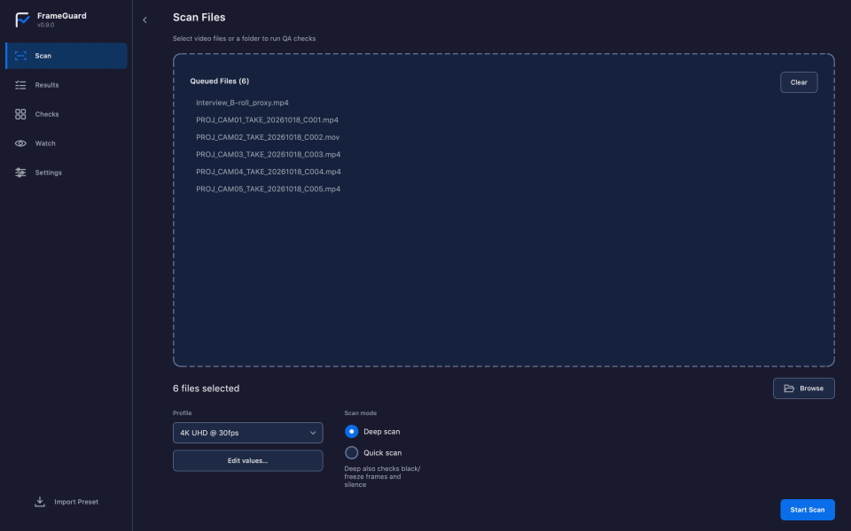

A real deep scan in FrameGuard v0.8.3: six test files checked against the 4K UHD @ 30 fps profile. Two pass, two pass with warnings (a burst of black frames, a stretch of silence) and two fail (a 1080p 24 fps proxy, and a 4K file encoded at less than half the minimum bitrate). The demo then steps through a failure, a warning and a pass on the Results page and ends on the Checks matrix.

[Watch the longer v0.8.0 walkthrough (MP4)](assets/frameguard-demo.mp4). It shows an earlier version of the interface.

## Screenshots

Every image below was captured from the running application (v0.8.3) after a real scan of the same six test files. Nothing was mocked up or edited.

| | |
|:---:|:---:|
| 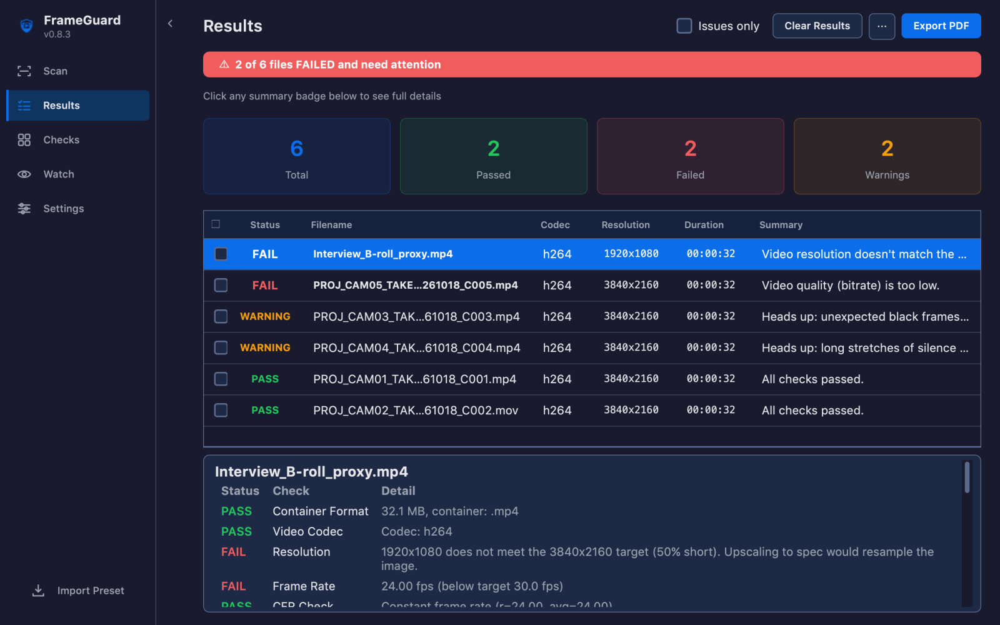 | 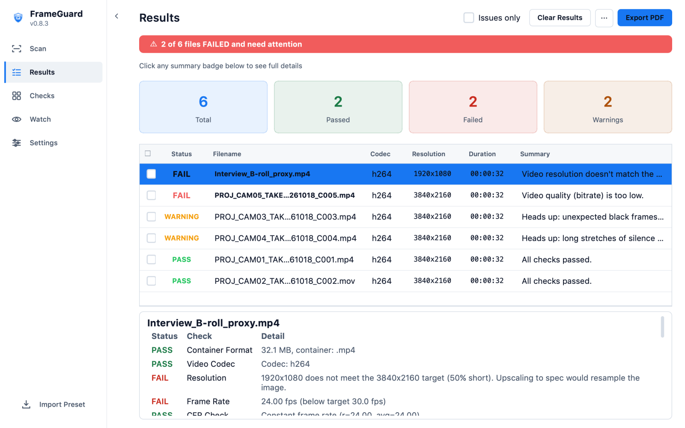 |
| **Results** · Blue Hour | **Results** · Clean Light |
| 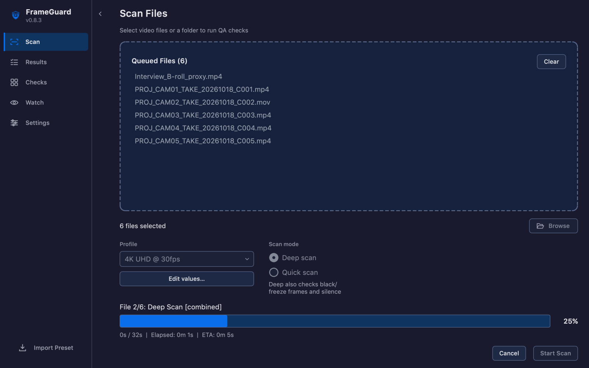 | 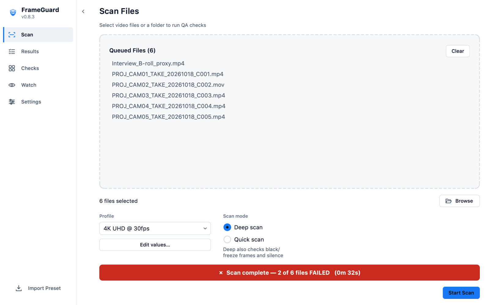 |
| **Scanning** · Blue Hour | **Scan complete** · Clean Light |
| 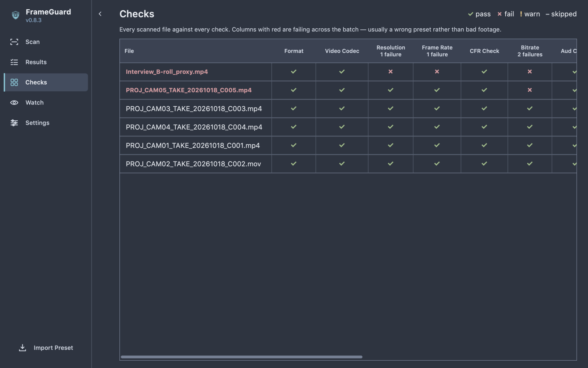 | 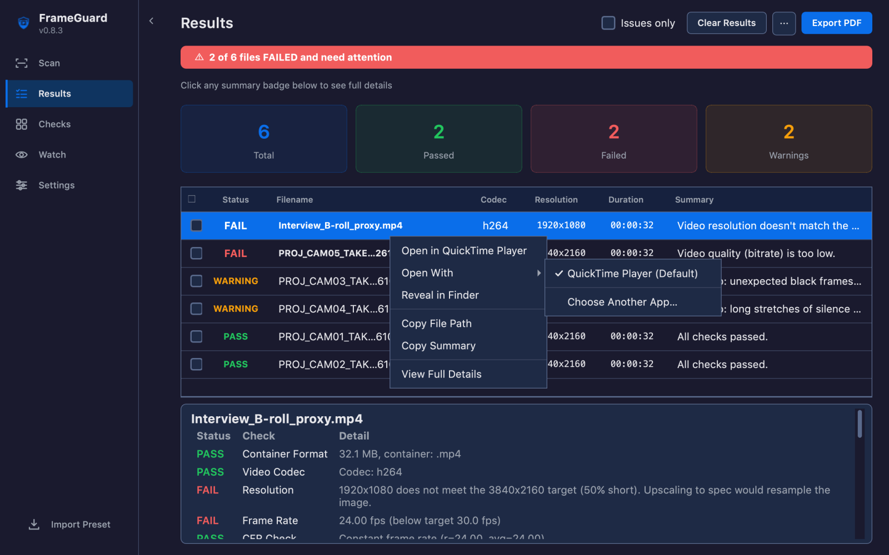 |
| **Checks matrix** · Nord Frost | **Open With** · Blue Hour |
| 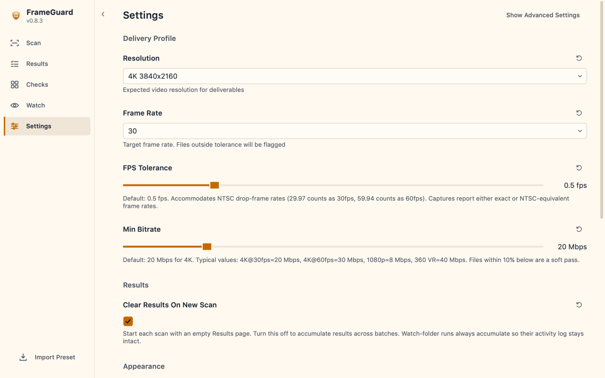 | 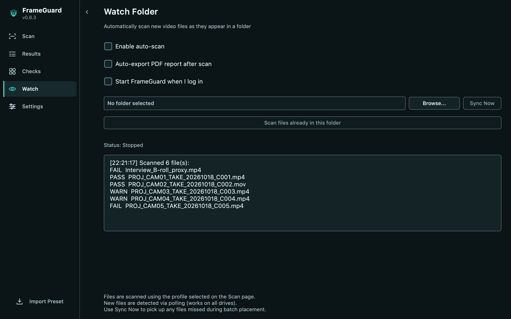 |
| **Settings** · Warm Cream | **Watch Folder** · Abyss Teal |

The menus in the Open With image were captured from the live menus and composited onto the window, because they open as separate pop-up windows. The players listed are the ones installed on the capture machine.

### PDF report

The same scan exported as a PDF. The report follows the active theme. Download the [sample report (PDF)](assets/screenshots/sample-report.pdf).

| | |
|:---:|:---:|
| 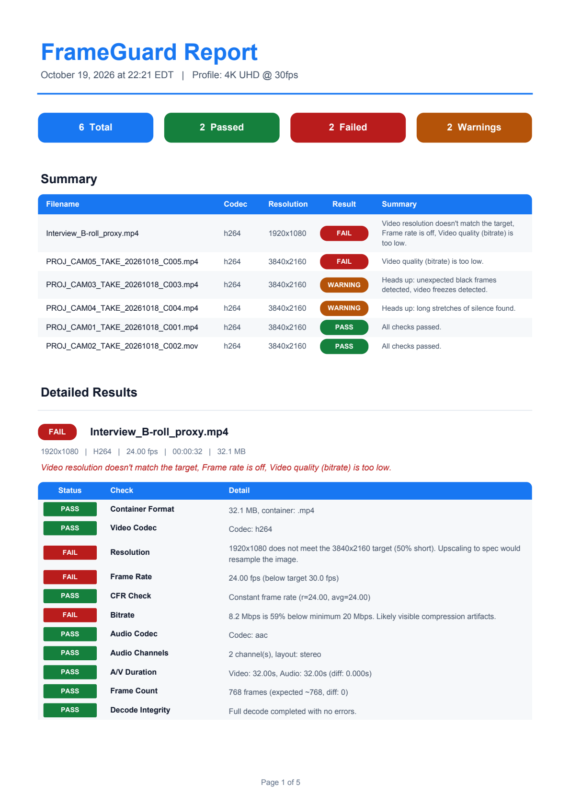 | 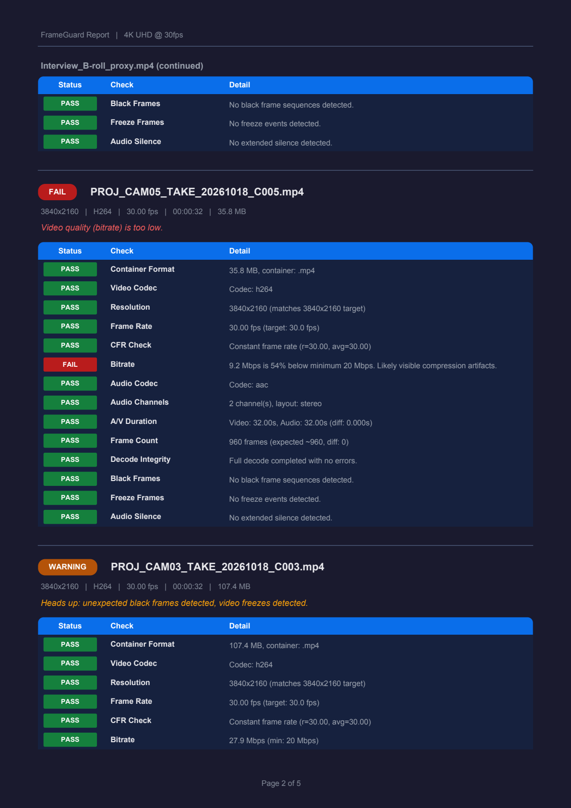 |
| Page 1 · Clean Light | Page 2 · Blue Hour |

## Download

Get the latest version from the
[Releases page](https://github.com/cass-ale/FrameGuard/releases/latest):

| Platform | File | Requirements |
|----------|------|--------------|
| Windows | `FrameGuardInstaller.exe` | Windows 10/11, 64-bit |
| macOS (Apple Silicon) | `FrameGuard-arm64.dmg` | macOS 12 or later |
| macOS (Intel) | `FrameGuard-intel.dmg` | macOS 12 or later |

**Windows:** run the installer — no Python or other dependencies needed,
FFmpeg and MediaInfo are bundled. FrameGuard is not yet code-signed, so
SmartScreen may ask once on first run: choose **More info**, then
**Run anyway**.

**macOS:** open the DMG for your Mac's chip and drag FrameGuard into
Applications. The build is ad-hoc signed but not notarized by Apple, so
Gatekeeper blocks the first launch of a downloaded copy:

- **macOS 15 or later:** double-click FrameGuard, choose **Done** in the
  dialog (not Move to Trash), then open System Settings →
  Privacy & Security, scroll to Security, and click **Open Anyway** next
  to the FrameGuard message. Authenticate, then launch FrameGuard again
  and confirm **Open**. (Right-click → Open no longer works on macOS 15+.)
- **macOS 14 or earlier:** right-click FrameGuard and choose **Open**.
- If the app is reported as damaged, or Open Anyway doesn't appear,
  removing the download quarantine fixes it:
  `xattr -dr com.apple.quarantine /Applications/FrameGuard.app`

Every release also publishes `SHA256SUMS.txt`, a build-provenance
attestation for each binary (verify with
`gh attestation verify <file> --owner cass-ale`), and an SBOM of the
bundled Python components. See [CODE_SIGNING_POLICY.md](CODE_SIGNING_POLICY.md)
for the signing status and roadmap.

**Updates:** FrameGuard checks GitHub Releases automatically and offers the
correct Windows, Apple Silicon, or Intel installer when a newer version is
available. Teams with their own filesystem or static artifact host can opt into
differential updates from Settings; no extra channel is required for normal use.

Prefer to run from source? See [Quick start](#quick-start) below.

## Why

XR and high-volume video shoots produce hundreds of files a day. Checking each one by
hand — resolution, frame rate, codecs, audio, corrupt frames — is slow, inconsistent,
and easy to get wrong at the end of a long shoot day. A bad file discovered in post
can mean an expensive reshoot or a compromised deliverable.

FrameGuard automates the tedious, error-prone part: point it at a folder and it checks
every file against your delivery spec, tells you what failed and why, and hands you a
PDF report. Hours of manual QC become a background task.

## Features

### Scan engine

- Automated checks across container, codec, resolution, frame rate, CFR, bitrate,
  audio codec/channels, A/V sync, and frame count
- **Deep scan** — black frame, freeze frame, and silence detection with absolute
  timestamps
- **Decode integrity** — detects dropped frames and decode errors during a full decode
- **Keyframe-aware segment splitting** for faster parallel deep scans on long files
- **Hardware-accelerated decode** (CUDA / VAAPI / D3D11VA / VideoToolbox, auto-detected)
- **MediaInfo enrichment** when MediaInfo is available
- **9 built-in delivery presets** (4K 24/30/60, 1080p 24/30/60, 720p30, 5.7K VR, 8K)
- **Confidence-weighted results** — borderline failures are reported as advisory rather
  than hard failures
- **Plain-language summaries** — one line per file, free of technical jargon

### Desktop GUI

- Drag-and-drop files, folders, and `.fg` presets — anywhere in the window
- Results stream in one file at a time as the scan progresses
- **Failures first, severity-weighted** — failed files sort to the top with
  critical corruption above minor framerate issues, tinted red with a headline
  banner; toggle back to scan order at any time
- Verdict banner auto-dismisses clean results and clears on new files,
  navigation, or errors — no stale messages
- **Checks matrix** — every file against every check in one grid, so a systemic
  problem ("all 40 files failing Bitrate") is obvious at a glance
- **Issues only** filter to hide files that passed cleanly
- **Open With** — open one or many results in any video player installed on the
  machine (QuickTime Player, VLC, IINA, TV and others on macOS; VLC, MPC-HC/BE,
  PotPlayer, mpv and the system chooser on Windows). The last player you used is
  remembered. Right-click a result to reveal it in Explorer or Finder, or to copy its path.
- **PDF handoff reports** with a batch summary and per-file detail. File names in any
  language render correctly, each file's checks stay together across page breaks, and
  pages are numbered "Page X of Y"
- **15 color themes** with live switching and persistence — the
  theme also recolors the app icon, title bar, and system tray icon
- Scan settings persist between sessions
- Watch folder with automatic scanning and tray notifications
- Standard window behaviour: Aero Snap, drag-to-maximize, Win+Arrow tiling
- Keyboard shortcuts: `Ctrl+1..5` panels, `Ctrl+O` browse, `F5` scan, `Ctrl+E` export,
  `Return` opens the highlighted result and `Ctrl+Shift+O` opens the checked results in
  your player (`Cmd` on macOS)
- Quitting always quits, even while a watch folder is running in the menu bar or tray

### Packaging

- Single-file installer with FFmpeg, FFprobe, and MediaInfo bundled — no dependencies
  for end users
- `.fg` preset files are registered with Windows: they show the FrameGuard icon and
  import on double-click

## Tech stack

Python · PySide6 (Qt) · FFmpeg / FFprobe · MediaInfo · PyInstaller · Inno Setup (Windows) / DMG (macOS)

## Quick start

### Run from source

```bash
cd src
pip install -r requirements.txt
python main.py
```

| Dependency | Version | Purpose |
|-----------|---------|---------|
| Python | 3.10+ | Runtime |
| PySide6 | 6.6+ | GUI framework |
| fpdf2 | 2.7+ | PDF report generation |
| psutil | 5.9+ | Subprocess cleanup |
| FFmpeg + FFprobe | 4.0+ | Video analysis (required) |
| MediaInfo | any | Enriched metadata (optional) |

FFmpeg is discovered from, in order: the bundled `tools/` directory (inside the
`.app` on macOS), `tools_cache/<platform>/` in the source tree, your `PATH`,
then common install locations including Homebrew and MacPorts.

### Build the installer

```batch
cd src
build_installer.bat          :: Windows -> Output\FrameGuardInstaller.exe
```

```bash
cd src
./build_mac.sh               # macOS -> Output/FrameGuard.dmg
```

See [BUILD_README.md](src/BUILD_README.md). Every push runs the full,
constrained suite on Windows, Apple Silicon, and Intel macOS. Release builders
also run packaging gates and self-test each packaged application.

The macOS build is ad-hoc signed rather than notarized. On macOS 15 or later,
use System Settings → Privacy & Security → **Open Anyway** after the first
blocked launch; on macOS 14 or earlier, right-click FrameGuard and choose
**Open**. See
[BUILD_README.md](src/BUILD_README.md#gatekeeper--read-this-before-distributing).

### Run the tests

```bash
cd src
pip install -c constraints-3.12.txt -r requirements-dev.txt
pytest
```

---

## Presets

Presets use the `.fg` extension (JSON internally). They capture a complete delivery
spec — resolution, frame rate and tolerance, minimum bitrate, accepted codecs and
containers, audio requirements, and deep-scan tuning.

| Action | How |
|--------|-----|
| Use a built-in | Pick it from the dropdown on the Scan page |
| Enter your own values | Scan page → **Edit values…** (jumps to the delivery controls and selects the Custom profile) |
| Save your setup as a `.fg` | Settings → Scan Presets → **Export Current**, then give it a name |
| Load one | **Import Preset** in Settings, drag the `.fg` onto the window, or double-click it |
| Share with the team | Send the `.fg` file — it is a few KB of plain JSON |

### Creating a `.fg` file

There is no separate file format to learn: a preset is just the values already on
the Settings page, written to disk.

1. Scan page → **Edit values…** (or Settings → Delivery Profile).
2. Set resolution, frame rate, tolerance and minimum bitrate. Expand
   **Show Advanced Settings** for audio and deep-scan parameters.
3. Settings → Scan Presets → **Export Current** → name it → Save.

The result is a small JSON file you can email, drop in a shared folder, or commit.
Anyone who drags it onto FrameGuard gets your exact spec. Hand-authoring one also
works — see `PRESET_CONFIG_KEYS` in `src/frameguard/presets.py` for the accepted keys,
and `src/presets/` for worked examples.

User-imported presets are stored in `~/.frameguard/presets/` and persist across
reinstalls.

---

## Project layout

```
FrameGuard/
├── README.md                 # This file
├── LICENSE                   # MIT
├── src/
│   ├── main.py               # Entry point (handles .fg paths from argv)
│   ├── requirements.txt      # Runtime dependencies
│   ├── requirements-dev.txt  # + pytest, pyflakes, pyinstaller
│   ├── pytest.ini
│   ├── README.md             # Pointer to the root README
│   ├── BUILD_README.md       # Build instructions
│   ├── frameguard/
│   │   ├── __init__.py       # Single source of truth for __version__
│   │   ├── core.py           # Scan engine, checks, deep scan
│   │   ├── worker.py         # Background scan thread
│   │   ├── gui.py            # PySide6 UI
│   │   ├── report.py         # PDF report generation
│   │   ├── presets.py        # .fg preset schema, import/export
│   │   ├── theme.py          # 15 color themes
│   │   ├── tools.py          # FFmpeg/MediaInfo discovery
│   │   ├── watchfolder.py    # Watch folder monitor
│   │   ├── manifest.py       # File manifest for differential updates
│   │   ├── deltaupdate.py    # Differential update staging and swap
│   │   └── updater.py        # Auto-update
│   ├── presets/              # Bundled .json presets (shipped in the installer)
│   ├── assets/               # Icons and logos
│   ├── tests/                # pytest suite
│   ├── tools_dev/            # Developer-only utilities (GUI audit)
│   ├── build_installer.bat   # Windows build
│   ├── build_mac.sh          # macOS build
│   ├── frameguard.spec       # PyInstaller config
│   ├── installer.iss         # Inno Setup config
│   └── validate_version.py   # Build-time version consistency check
```

Build state is platform-owned. Windows uses `.buildenv/`, `build/`, and
`dist/` in the checkout. macOS uses `~/Library/Caches/FrameGuard/<checkout>/`
because Google Drive cannot preserve Qt's framework symlinks; only the finished
DMG is copied to `Output/`. Building one platform therefore does not delete or
overwrite the other's artifacts.

---

## Configuration

Everything is configurable from the Settings panel and persists between sessions.
Defaults live in `DEFAULT_CONFIG` in `frameguard/core.py`; the Settings panel emits
those exact key names, and `tests/test_config_and_presets.py` enforces that they stay
in sync.

| Group | Controls |
|-------|----------|
| Delivery | Target resolution, frame rate, fps tolerance, minimum bitrate |
| Audio | Audio required, silence duration threshold |
| Deep scan | Hardware acceleration, segmented scanning, segment count |
| Strict mode | Warnings are treated as failures |

---

## Check reference

| Category | Check | Severity | Notes |
|----------|-------|----------|-------|
| Container | Format | FAIL | Extension must be in accepted containers |
| Video | Codec | FAIL | Must be in accepted codec list |
| Video | Frame Rate | FAIL/WARN | FAIL below target, WARN above target (conformance-friendly) |
| Video | CFR | FAIL/WARN | Constant frame rate (configurable) |
| Video | Bitrate | FAIL/WARN | WARN 10-25% under target, FAIL beyond |
| Video | Frame Count | WARN | Frame count vs duration × fps |
| Audio | Codec | FAIL | Must be in accepted audio codec list |
| Audio | Channels | INFO | Reports channel count and layout |
| Audio | Silence | FAIL/WARN | Sustained silence detection |
| Duration | A/V Sync | FAIL | Audio vs video duration mismatch |
| Deep scan | Decode Integrity | WARN | Decode errors during full decode |
| Deep scan | Black Frames | FAIL/WARN | Fade-filtered, absolute timestamps |
| Deep scan | Freeze Frames | FAIL/WARN | Sustained frozen frames |
| Metadata | MediaInfo | INFO | Enriched metadata when available |

Only **essential** checks determine pass/fail. Advisory checks (decode integrity, frame
count, black frames, freeze frames) produce `PASS_WITH_WARNINGS` rather than a failure.

---

## Privacy

All video processing is local. Nothing is uploaded, transmitted, or shared.

---

## License

MIT License. See [LICENSE](LICENSE).

Copyright (c) 2026 Cassian Aléria. Published by Capri la Ria.
